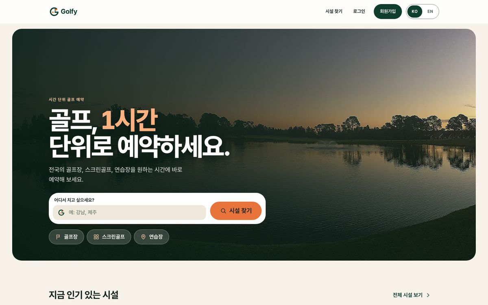
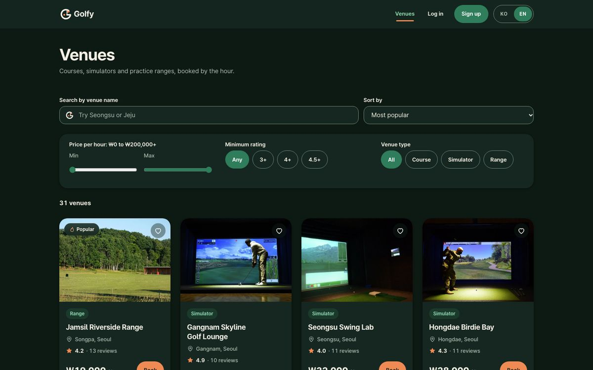
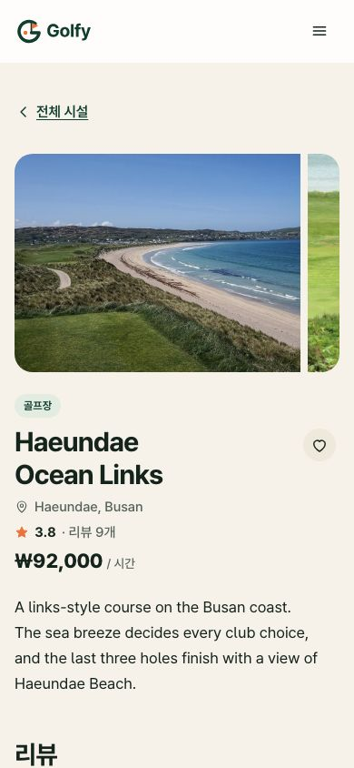
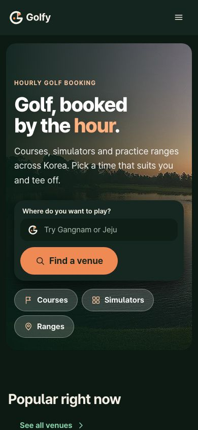
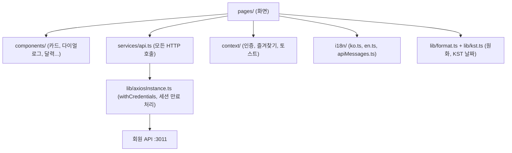

<p align="center"></p>

# Golfy 회원 앱

[English](README.md) · [한국어](README.ko.md)

  

**Golfy**는 골프장, 스크린골프, 골프연습장을 1시간 단위로 예약하는 서비스이고, 이 저장소는 회원용 웹 앱입니다. 시설을 찾고, 빈 시간을 확인하고, 예약하고, 결제(시뮬레이션)하고, 리뷰를 남길 수 있습니다. 포트폴리오 프로젝트이며 시설은 모두 가상의 데모 데이터입니다.

**세 저장소:** [golfy-backend](../GOLFY%20Backend)(API: 회원 `:3011` / 관리자 `:3012`) · **golfy-frontend**(이 앱, `:3000`) · [golfy-admin](../../golfy-admin)(직원용 대시보드, `:3001`). 세 앱이 어떻게 연결되는지는 백엔드 README에 10줄로 정리되어 있습니다.

| 홈 (KO) | 시설 목록 (EN, 다크) | 시설 상세 (KO, 모바일) | 홈 (EN, 모바일, 다크) |
| --- | --- | --- | --- |
|  |  |  |  |

## 주요 기능

- 기본 언어는 한국어이며 접근성을 고려한 **KO | EN** 전환을 제공합니다(저장된 선택 → 브라우저 언어 → 한국어 순). `<html lang>`도 함께 바뀝니다.
- 시설 검색, 필터(1시간 요금·평점·유형), 정렬, 페이지 처리. 상태는 URL에 유지됩니다.
- 달력과 24시간 시간 선택기: 실시간 예약 현황, 연속 시간 선택, 충돌 안내
- 60분 보류 카운트다운이 있는 결제, 시뮬레이션 결제, `.ics` 캘린더 파일이 있는 확인서
- 내 예약(탭, 취소, 이용 완료 처리), 평점 리뷰, 되돌리기가 있는 즐겨찾기, 사진·비밀번호 변경이 있는 내 정보
- 라이트/다크 테마, 44px 터치 영역, 포커스 표시, 모션 줄이기 지원, 고정 비율의 지연 로딩 사진
- 사진은 위키미디어 공용의 실제 사진이며, 푸터에서 사진 출처 페이지로 연결됩니다.

## 기술 스택

React 18, TypeScript, react-router 7, axios, react-i18next, 디자인 토큰 기반 직접 작성 CSS, Create React App, Jest + React Testing Library, Playwright(선택)

## 구조



폴더 설명은 [영문 README](README.md#architecture)와 같습니다.

## 규칙

- **KST:** 날짜, "오늘", 시간 확인, 지난 시간 차단, 캘린더 파일은 모두 `lib/kst.ts`를 거치므로 브라우저 시간대와 무관합니다(두 시간대로 테스트). 예약일은 KST 달력 날짜이고 시간은 KST 기준입니다.
- **i18n:** 컴포넌트에 사용자에게 보이는 문자열을 직접 쓰지 않고 `t("섹션.키")`만 사용합니다. 키는 `i18n/en.ts`와 `i18n/ko.ts` **양쪽**에 추가해야 하며, 다르면 테스트가 실패합니다. 백엔드 오류 메시지는 영어로 유지하고 `i18n/apiMessages.ts`가 알려진 메시지만 번역하며, 모르는 메시지는 원문을 보여 줍니다. 영어 원문이 필요한 로직은 `apiError(err).raw`를 사용합니다.
- **금액:** 두 언어 모두 `₩` + ko-KR 천 단위 구분(`money()`), 가격은 정수입니다.
- **로고:** `BrandLogo` / `BrandMark`로만 사용합니다(테마에 맞는 파일을 자동 선택).

## 라우트

`/` 홈 · `/venues` 목록 · `/venues/:id` 상세·예약 · `/login`, `/signup` · `/checkout/:id`, `/confirmation/:id`, `/bookings`, `/review/:bookingId`, `/favourites`, `/profile`(로그인 필요) · `/credits` 사진 출처

## 실행

```bash
yarn install
yarn start        # http://localhost:3000, API 주소는 REACT_APP_API_URL (기본 http://localhost:3011)
yarn typecheck && yarn lint && yarn test --watchAll=false && yarn build
yarn e2e          # 선택: :3011에 시드가 있는 백엔드와 `yarn start` 필요, 설치된 Chrome 사용
```

[백엔드](../GOLFY%20Backend)를 `npm run seed:reset` 후 실행해야 합니다. 데모 회원: `minjun@seed.golfy.dev` / `Password123!`

| 변수 | 설명 |
| --- | --- |
| `REACT_APP_API_URL` | 회원 API 주소(기본 `http://localhost:3011`) |
| `REACT_APP_SITE_URL` | 앱의 공개 주소. 빌드 시 `og:image`, `og:url`, `canonical`을 절대 주소로 만듭니다(`.env.example` 참고) |

## 설계 결정과 트레이드오프

- UI 프레임워크 대신 작은 토큰 체계의 일반 CSS: 번들이 작고 통제가 쉽지만 손이 더 갑니다.
- 상태는 URL과 작은 컨텍스트에 둡니다(Redux 없음): 이 규모에서는 충분합니다.
- 모든 호출은 `services/api.ts` 한 곳을 거치므로 테스트에서는 이 모듈 하나만 대체하면 됩니다.
- CRA를 유지했고, 남은 `yarn audit` 항목은 CRA 빌드 도구에서 나옵니다.

## 한계

결제 시뮬레이션, 데모 데이터만 제공, 오프라인 모드 없음, 한국어 문구는 원어민 교정을 거치지 않았음, CRA는 더 이상 유지보수되지 않음

## 다음에 할 일

1. CRA에서 Vite로 이전(대부분의 audit 항목 해소, 빌드 속도 향상)
2. 두 언어·두 테마의 시각 회귀 테스트
3. 실제 결제 단계와 카카오/네이버 로그인
4. 시설 지도와 거리순 정렬
