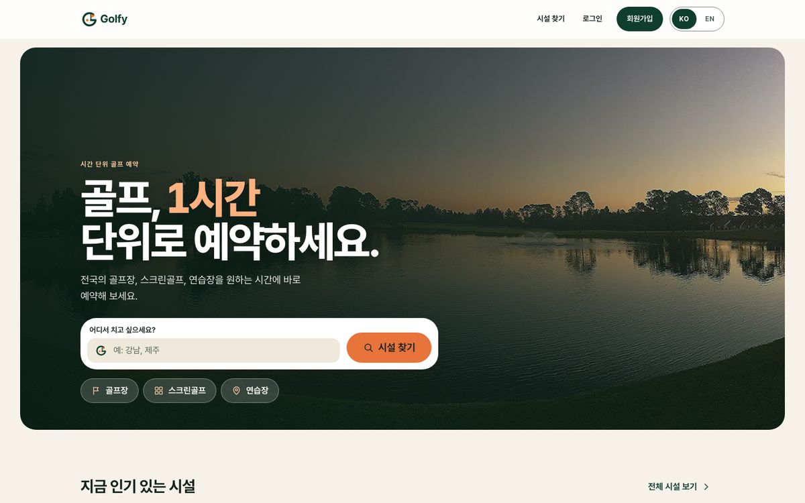
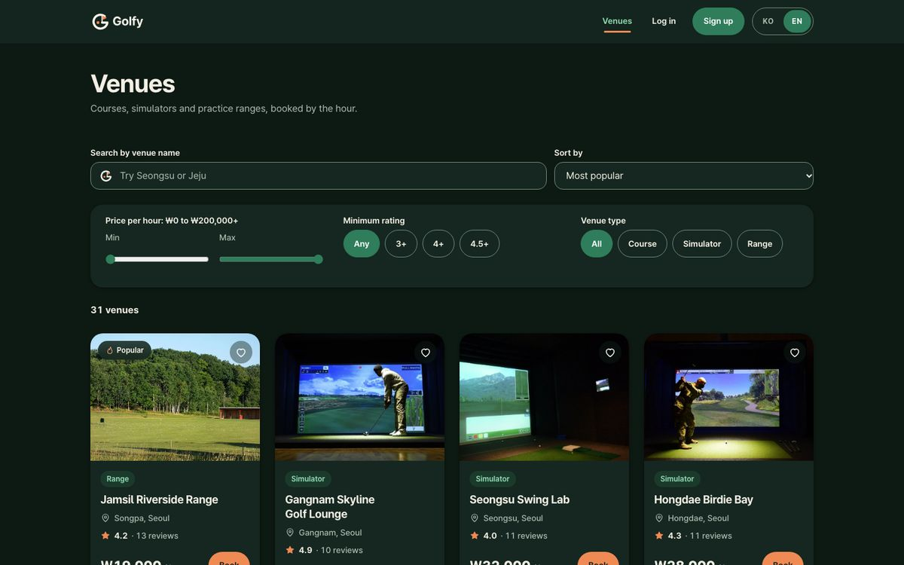
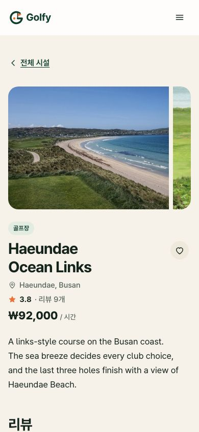
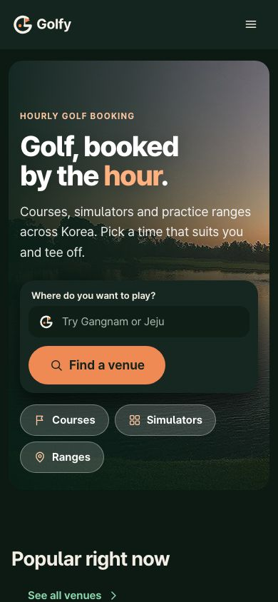
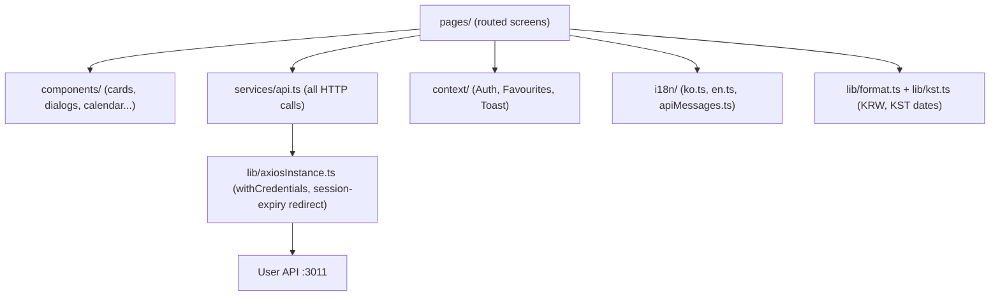

<p align="center"></p>

# Golfy player app

[English](README.md) · [한국어](README.ko.md)

[](https://github.com/avazqudratovv-mit/Golfy-Frontend-User/actions/workflows/ci.yml)  

The web app for players of **Golfy**, an hourly golf-venue booking platform for Korea. Find a course, simulator or driving range, see the free hours, book, "pay" and review. Payment is simulated for now and is under development.

**Part of three repos:** [golfy-backend](https://github.com/avazqudratovv-mit/Golfy-backend) (API, `:3011` user / `:3012` admin) · **[golfy-frontend](https://github.com/avazqudratovv-mit/Golfy-Frontend-User)** (this app, `:3000`) · [golfy-admin](https://github.com/avazqudratovv-mit/Golfy-Frontend-Admin) (staff dashboard, `:3001`). The backend README has a 10-line overview of how they fit together.

| Home (KO) | Venues (EN, dark) | Venue (KO, mobile) | Home (EN, mobile, dark) |
| --- | --- | --- | --- |
|  |  |  |  |

## Features

- Korean by default with an accessible **KO | EN** toggle (saved choice, then browser language, then Korean); `<html lang>` follows.
- Venue search, filters (won per hour, rating, type), sorting, pagination; URL keeps the state.
- Calendar and 24-hour slot picker with live availability, range selection and conflict messages.
- Checkout with a 60-minute hold countdown, simulated payment, receipt with an `.ics` calendar file.
- My bookings (tabs, cancel, mark finished), reviews with rating, favourites with undo, profile with avatar and password change.
- Light/dark theme, 44 px touch targets, visible focus, reduced-motion support, lazy-loaded photos with fixed aspect ratios.
- Photos are real Wikimedia Commons photographs; the footer links to a credits page.

## Tech stack

React 18, TypeScript, react-router 7, axios, react-i18next, hand-written CSS with design tokens, Create React App, Jest + React Testing Library, Playwright (optional).

## Architecture



```
src/app/pages       routed screens        src/app/components  Layout, ui.tsx, AuthShell, Brand, LangToggle
src/app/lib         format.ts, kst.ts, types, config   src/app/services/api.ts  API calls
src/app/context     Auth, Favourites, Toast            src/i18n  resources + language detection
src/css             tokens -> base -> icons -> components -> site -> motion
public/brand        logo set (single source of truth)   e2e/  Playwright smoke test
```

## Conventions

- **KST:** every date, "today", hour check, past-slot block and calendar file goes through `lib/kst.ts`, so the result does not depend on the browser's time zone (tests run under two zones). The booking day is a KST calendar day; slot times are KST wall-clock.
- **i18n:** no user-facing literal in components, only `t("section.key")`. Add a key to **both** `i18n/en.ts` and `i18n/ko.ts` (a test fails when they differ). Backend error messages stay English: `i18n/apiMessages.ts` maps known ones to translated text and falls back to the raw message; logic that needs the English text uses `apiError(err).raw`.
- **Money:** won, `₩` + ko-KR grouping in both languages (`money()`); prices are integers.
- **Logo:** only via `BrandLogo` / `BrandMark` (they pick the light/dark file by theme).

## Routes

`/` home · `/venues` list · `/venues/:id` detail and booking · `/login`, `/signup` · `/checkout/:id`, `/confirmation/:id`, `/bookings`, `/review/:bookingId`, `/favourites`, `/profile` (need login) · `/credits` photo credits.

## Run

```bash
yarn install
yarn start        # http://localhost:3000, API from REACT_APP_API_URL (default http://localhost:3011)
yarn typecheck && yarn lint && yarn test --watchAll=false && yarn build
yarn e2e          # optional smoke test: needs the backend with seeded data on :3011 and `yarn start`; uses your installed Chrome
```

Needs the [backend](https://github.com/avazqudratovv-mit/Golfy-backend) running with `npm run seed:reset`. Seed player: `minjun@seed.golfy.dev` / `Password123!`.

| Variable | Purpose |
| --- | --- |
| `REACT_APP_API_URL` | user API base (default `http://localhost:3011`) |
| `REACT_APP_SITE_URL` | public base URL of this app; at build time it makes `og:image`, `og:url` and `canonical` absolute (see `.env.example`) |

## Key decisions and trade-offs

- Plain CSS with a small token system instead of a UI framework: small bundle, full control, more manual work.
- State lives in URLs and small contexts (no Redux): fine at this size.
- Pages call one `services/api.ts`; mocks in tests replace that single module.
- CRA is kept to avoid churn; its build tooling is where the remaining `yarn audit` items are.

## Limitations

Simulated payment (under development), no offline mode, the Korean copy has not been reviewed by a native editor, CRA is no longer maintained.

## What I would do next

1. Move from CRA to Vite (clears most audit items and speeds up builds).
2. Visual regression tests for both languages and themes.
3. Real payment step and Kakao/Naver sign-in.
4. Venue map and distance sorting.
